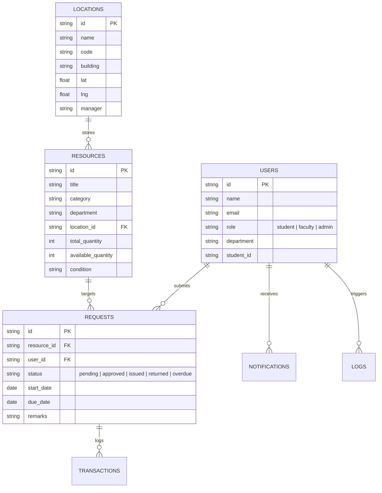

# 🌐 Smart Campus Resource Hub

> A modern full-stack platform for university students, faculty, and lab managers to discover, request, borrow, and audit campus resources with location proximity matching and inventory analytics.

---

## 🚀 Key Highlights & Implemented Features

### 💻 1. Frontend (React 19 + Vite + Tailwind CSS)
- **Role-Based Experience**: Seamless 1-click switcher between **Student** (*Alice Walker*), **Faculty** (*Prof. Alan Vance*), and **Campus Admin** (*Chief Resource Officer*).
- **Categorized Resource Catalog**: Textbooks, Lab Equipment, Electronics/IoT kits, Lecture Notes, and Media Gear with real-time stock counters (`Available`, `Low Stock`, `All Borrowed`).
- **Interactive Borrow System**: Custom duration slider (up to max loan limit), purpose description, calculated due date, and celebratory confetti upon approval.
- **📍 Location-Aware Hub Matching**: Proximity matching with real-time distance calculations (e.g. *Central Library: 120m away*, *Alan Turing CS Lab*, *Tesla IoT Center*, *Edison Fabrication Bay*).
- **📊 Analytics & Shortages Dashboard**: Live KPIs, popularity leaderboard, critical out-of-stock alerts, category utilization meters, and real-time audit event feed.
- **🔔 Notification Center**: Live in-app notifications for due dates, pickup approvals, and overdue warnings with a **Simulate Automated Event** tool for testing SMS and Email alerts.

### ⚙️ 2. Backend (Node.js + Express REST API)
- **Authentication & RBAC**: JWT Bearer token authentication with Role-Based Access Control (`student`, `faculty`, `admin`).
- **Relational Atomic Database (`db.js`)**: Structured persistent storage supporting users, resources, requests, transactions, notifications, locations, and audit logs.
- **Borrow/Return Workflow Engine**:
  - `pending` ➔ `approved` (Faculty / Admin review with remarks)
  - `approved` ➔ `issued` (Physical handover at lab, auto-decrements stock)
  - `issued` ➔ `returned` (Condition verified, restores stock)
  - `issued` ➔ `overdue` (Auto-flagged daemon with urgent notification)
- **Automated Overdue Daemon**: Periodic background check identifying loans exceeding due dates and queuing alerts.

---

## 🏛️ System Architecture

```mermaid
graph TD
    Client["React 19 + Tailwind CSS + Lucide (Vite :5173)"]
    API["Express.js REST API Server (:5000)"]
    Auth["JWT & RBAC Middleware"]
    DB[("Relational File-Backed DB (db.js / data.json)")]
    Daemon["Overdue Loan Monitor Daemon"]

    Client -->|HTTP / JSON (REST)| API
    API --> Auth
    Auth --> DB
    Daemon -->|Runs every 5 mins| DB
    API -->|Real-time Stats| Client
```

---

## 📊 Database Schema (Entity Relationship)



---

## 🔑 Pre-Seeded Demo Accounts

You can switch identities instantly using the **identity switcher** in the top-right corner of the Navbar, or log in manually:

| Role | Name | Email | Password | Department / Notes |
| :--- | :--- | :--- | :--- | :--- |
| **Student** | Alice Walker | `alice@campus.edu` | `password123` | Computer Science (Has active & approved loans) |
| **Student** | Rahul Sharma | `rahul@campus.edu` | `password123` | Electronics (Has pending request & overdue loan) |
| **Faculty** | Prof. Alan Vance | `vance@campus.edu` | `password123` | CS Associate Professor & Lab In-Charge |
| **Faculty** | Dr. Meera Rao | `meera@campus.edu` | `password123` | ECE Professor & Hardware Lab Director |
| **Admin** | Chief Resource Officer | `admin@campus.edu` | `admin123` | Central Campus Services (Full privileges) |

---

## 🛠️ Getting Started

### Prerequisites
- Node.js LTS (v20+ installed in user environment)

### Launching with One Command (PowerShell)
```powershell
.\start-dev.ps1
```

### Or Launching Individually

#### 1. Backend Server
```bash
cd backend
npm install
npm start
# Runs on http://localhost:5000
```

#### 2. Frontend Application
```bash
cd frontend
npm install
npm run dev
# Runs on http://localhost:5173
```

---

## 📡 REST API Reference

| Method | Endpoint | Access | Description |
| :--- | :--- | :--- | :--- |
| `POST` | `/api/auth/login` | Public | Authenticate user, returns JWT and user profile |
| `POST` | `/api/auth/register` | Public | Register student or faculty account |
| `GET` | `/api/auth/me` | Authenticated | Retrieve current user profile |
| `POST` | `/api/auth/quick-switch`| Public | Fast role switching for testing & demoing |
| `GET` | `/api/resources` | Public | List catalog with search, category, location, and distance filters |
| `POST` | `/api/resources` | Faculty / Admin | Register new lab apparatus or study resource |
| `PUT` | `/api/resources/:id` | Faculty / Admin | Update metadata, condition, or stock |
| `DELETE`| `/api/resources/:id` | Admin | Permanently retire or archive resource |
| `GET` | `/api/requests` | Authenticated | View requests (filtered by role and permissions) |
| `POST` | `/api/requests` | Student / Faculty | Submit new borrow request |
| `PUT` | `/api/requests/:id/status`| Faculty / Admin | Transition status: `approve`, `reject`, `issue`, `return` |
| `PUT` | `/api/requests/:id/extend`| Student / Faculty | Extend active loan by +3 days |
| `GET` | `/api/analytics/dashboard` | Authenticated | KPIs, shortage warnings, most borrowed leaderboard |
| `GET` | `/api/locations` | Public | Campus hubs, coordinates, operating hours, and inventory |
| `GET` | `/api/notifications` | Authenticated | In-app alerts, unread counter, simulated email/SMS logs |
| `POST` | `/api/notifications/simulate-event` | Authenticated | Trigger mock event-driven email or SMS delivery |
| `GET` | `/api/logs` | Faculty / Admin | Immutable audit log of every state change |
| `POST` | `/api/logs/reset-demo` | Public | Restore factory demo seed dataset |
